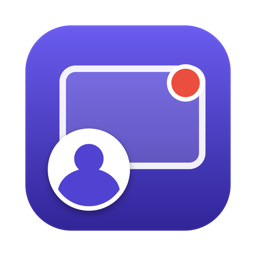

<p align="center"></p>

<h1 align="center">Bubblecast</h1>

<p align="center">Record your screen with your camera in a bubble. Everything stays on your Mac.</p>

Bubblecast is a small, native macOS screen recorder. It records the screen you choose, your microphone, and your camera in a draggable bubble (or full screen), and saves an MP4 to your Mac. There is no account, no cloud upload and no network code.

## Features

- **Screen + camera bubble**: record any display with your camera in a circle, rounded square or 4:3 bubble (S / M / L).
- **Full-screen camera**: switch between the bubble and a full-screen camera with one click, a double-click on the bubble, or ⌥⇧F, even while recording.
- **One control bar**: pick the screen, camera and microphone, then start. A 3-2-1 countdown, a pulsing timer and a red menu-bar icon show that you are recording.
- **Camera settings**: live preview, size, shape, filters (Warm, Cool, Mono, Bright, Vivid) and macOS Video Effects for background blur or replacement.
- **Private by design**: recordings go to `~/Movies/Bubblecast/<date>/<time>.mp4` and nowhere else. The control bar never appears in the video.
- **Guided setup**: on first launch Bubblecast asks for every permission it needs, so recording never stops on a prompt.

## Requirements

- macOS 15 Sequoia or later (Apple silicon or Intel)
- A camera and microphone (built-in or external)

## Install

1. Download **`Bubblecast-<version>.pkg`** from the [latest release](../../releases/latest).
2. Double-click it and follow the installer. Bubblecast is installed into **Applications** and opens by itself.
3. The first time only, macOS may say it cannot check the developer, because the app is not notarized by Apple. Open **System Settings → Privacy & Security** and click **Open Anyway**, then run the installer again.

## First launch

Bubblecast opens a **Set up Bubblecast** window:

1. **Camera → Allow** and **Microphone → Allow**.
2. **Screen Recording → Allow**. System Settings opens; turn on **Bubblecast**.
3. Click **Restart Bubblecast** (macOS applies the screen permission only after a restart), then **Continue**.

You can open this window again from the menu-bar icon → **Permissions…**. Permissions are asked once per Mac and are kept across updates.

## Use

| Action | How |
|---|---|
| Start / stop recording | **Start recording** on the bar, or ⌥⇧R |
| Camera on / off | Camera menu on the bar, or ⌥⇧M |
| Full-screen camera | Double-click the bubble, the ⤢ button while recording, or ⌥⇧F |
| Camera size, shape, filter, background | ⚙︎ button next to the Camera menu |
| Hide the bar | × on the bar (click the Dock icon to bring it back) |
| Open recordings | Menu-bar icon → **Open recordings folder** |
| Quit | ⌘Q, or menu-bar icon → **Quit** |

Only microphone audio is recorded (no system audio). The bubble is a real window on the recorded screen, so it stays inside that screen.

## Uninstall

1. Quit Bubblecast and move **/Applications/Bubblecast.app** to the Trash.
2. Optional: remove it from **System Settings → Privacy & Security → Screen & System Audio Recording** (and Camera, Microphone) with the **−** button.
3. Your recordings stay in `~/Movies/Bubblecast` until you delete them.

## Build from source

Requires Xcode 16 or later (Swift 6, macOS 15 SDK).

```sh
git clone https://github.com/mehedisarkar2k/bubblecast.git
cd bubblecast
bash scripts/release.sh            # builds, signs and packages
open dist/Bubblecast-*.pkg         # install
```

- `scripts/build-app.sh` builds `.build/package/Bubblecast.app` and signs it with the first certificate it finds ("Developer ID Application", "Apple Development", or a self-signed "Bubblecast Dev"; override with `BUBBLECAST_SIGN_IDENTITY`). Without one it signs ad-hoc with a bundle-identifier requirement, so permissions still carry over between builds.
- `scripts/make-pkg.sh` makes the installer in `dist/`. It quits a running copy before installing and opens the app afterwards.
- `scripts/make-icon.swift` draws the app icon; `Resources/AppIcon.icns` is made from it with `sips` and `iconutil`.

## License

[MIT](LICENSE) © 2026 Mehedi Hasan Sarkar
